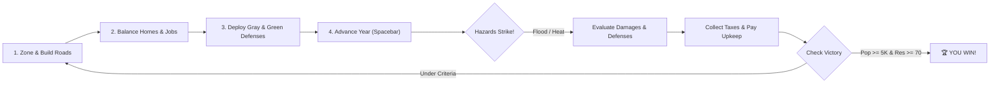

# Adaptasia 🏙️🌊🌡️

> **An educational, retro-styled climate adaptation city builder that runs in any browser with zero external dependencies.**

[](LICENSE)
[](package.json)
[](index.html)
[](CHANGELOG.md)
[](CONTRIBUTING.md)

---

## Table of Contents

- [About The Game](#about-the-game)
- [Key Features](#key-features)
- [Quick Start: Play Now](#quick-start-play-now)
- [How to Play](#how-to-play)
  - [Objectives & Win Conditions](#objectives--win-conditions)
  - [Controls & Shortcuts](#controls--shortcuts)
- [Gray vs. Green: Balancing Infrastructure](#gray-vs-green-balancing-infrastructure)
- [The Science Behind Adaptasia](#the-science-behind-adaptasia)
- [Architecture & Tech Stack](#architecture--tech-stack)
- [Repository Structure](#repository-structure)
- [Testing & Quality Assurance](#testing--quality-assurance)
- [Deployment](#deployment)
- [Roadmap & Future Vision](#roadmap--future-vision)
- [Contributing](#contributing)
- [License](#license)

---

## About The Game

**Adaptasia** puts you in the seat of an urban planner and chief resilience officer tasked with growing a vibrant riverfront city over a **30-year planning window**.

Unlike traditional city builders where the climate is static, in Adaptasia the climate warms and destabilizes with each passing year:
- **Riverine floods and coastal storm surges** grow more frequent, deeper, and unpredictable.
- **Urban heat islands (UHI)** bake treeless neighborhoods, causing illness, migration, and unhappiness.
- **Hard concrete defenses (levees and seawalls)** provide immediate safety, but carry high upkeep and risk catastrophic failure ("the levee effect") in extreme storms.
- **Nature-based solutions (wetlands, parks, green roofs, bioswales)** are cost-effective, cool the air, and absorb stormwater, but take time to mature.

Your mission: Balance economic growth, housing, and jobs while engineering a city that can survive the compound climate hazards of the 21st century.

---

## Key Features

- **Zero Dependencies & Single-File Engine**: Pure vanilla HTML5 Canvas and ES6 JavaScript. No React, Phaser, Node build steps, or external asset packs.
- **Procedural World Generation**: Deterministic seed-based generation (`mulberry32`) creates unique rivers, coastlines, floodplains, and hills with organic elevation contours.
- **Authentic Pixel Art Engine**: Custom-engineered 3x5 bitmap font atlas, autotiling 16-state roads, and animated weather effects (heat shimmers, flood waters, scars) drawn using a curated 24-color palette.
- **Real-World Climate Science**: Models compound flood inundation, non-stationary return periods, urban heat island dynamics, repetitive-loss building abandonment, and the FEMA/NIBS 6:1 disaster mitigation ROI.
- **Interactive Analytical Overlays**: Toggle real-time visualization layers for **Flood Risk** (Design Flood), **Urban Heat Island Score**, and **Land Value**.
- **Post-Game Reflection Engine**: Generates customized post-game lessons analyzing your specific infrastructure spending, failure points, and resilience trade-offs.

---

## Quick Start: Play Now

Because Adaptasia has no build steps, you can start playing in seconds.

### Method 1: Local HTTP Server (Recommended)
Clone the repository and launch a lightweight web server:

```bash
# Using Python:
python -m http.server 8000

# Or using Node / NPX:
npx serve .
```
Open **`http://localhost:8000`** in your browser.

### Method 2: Direct File Open
You can also directly double-click **`index.html`** or **`adaptasia.html`** to open it locally in Chrome, Firefox, Safari, or Edge.

---

## How to Play



### Objectives & Win Conditions

#### 🏆 Victory (Before or by Year 30)
1. **Population $\ge$ 5,000**
2. **Resilience Score $\ge$ 70 / 100**
3. **Budget $\ge$ \$0** (must not be in debt)

#### ⚠️ Defeat
- **Bankruptcy**: Budget remains below \$0 for **3 consecutive years**.
- **Revolt**: Happiness drops below 20% for **3 consecutive years**.
- **Time's Up**: Reaching Year 31 without meeting all victory criteria.

### Controls & Shortcuts

| Key / Input | Action |
| :--- | :--- |
| **Left Click / Tap** | Select tool, inspect tile, or construct building |
| **Click & Drag** | Rapidly paint roads and zones |
| **Spacebar** | Advance one year (`END YEAR`) / dismiss popups |
| **Escape** | Deselect active tile inspection |
| **SPEED Button** | Toggle Auto-Play mode (advances 1 year every 5 seconds) |
| **SAVE / LOAD** | Save and load city state via browser `localStorage` |

> [!TIP]
> **Need a deeper tactical breakdown?** Read the complete [Gameplay & Strategy Guide](docs/GAMEPLAY_GUIDE.md).

---

## Gray vs. Green: Balancing Infrastructure

| Type | Infrastructure | Cost | Upkeep | Key Effect | Failure Mode / Caveat |
| :--- | :--- | :--- | :--- | :--- | :--- |
| **Gray** | **Levee / Seawall** | \$3,000 | \$250/yr | Blocks floods up to 0.40 deep within 2 tiles | 15% breach rate in extreme storms; causes +0.12 surge penalty when breached. Reduces attractiveness (-3). |
| **Gray** | **Storm Drain** | \$1,500 | \$80/yr | Cuts flood depth by 0.10 within 3 tiles | 25% clogging rate in extreme downpours. |
| **Gray** | **Cooling Center** | \$2,000 | \$150/yr | Cuts heat wave harm by 60% within 4 tiles | Protects people from illness, but does not cool ambient air. |
| **Green** | **Wetland** | \$500 | \$10/yr | Soaks up 0.14 water depth within 3 tiles; cools +0.12 | Floodplains only; takes 3 years to reach full maturity. |
| **Green** | **Park / Trees** | \$350 | \$15/yr | Provides +0.20 cooling, +10 recreation, +0.08 land value | Takes 2 years to mature. |
| **Green** | **Green Roof** | \$200 | \$5/yr | Retrofits homes/shops: +0.08 cooling, stormwater retention | Requires existing residential/commercial structure. |
| **Green** | **Bioswale** | \$120 | \$3/yr | Lowers flood depth by 0.05, cools +0.03 within 1 tile | Takes 1 year to mature; low capacity. |

---

## The Science Behind Adaptasia

Adaptasia bridges urban planning and climate adaptation research:

- **Urban Heat Island (UHI)**: Simulates thermal mass from pavement and commercial buildings versus cooling buffers from canopy, water, and wetlands.
- **The "Levee Effect"**: Models geographer Gilbert F. White's paradox—building floodwalls fosters dense development behind them, creating catastrophic losses when the wall fails.
- **Mitigation ROI**: Incorporates FEMA/NIBS findings that \$1 invested in pre-disaster mitigation saves \$6 in future recovery costs.
- **Repetitive Losses**: Buildings that flood twice in 3 years are permanently abandoned, modeling uninsurability and forced displacement.

👉 *Read the full scientific foundation in [The Climate Science of Adaptasia](docs/CLIMATE_SCIENCE.md).*

---

## Architecture & Tech Stack

```
adaptasia.html / index.html
├── CONFIG       (Balancing, item tables, climate curves)
├── UTIL         (mulberry32 PRNG, Chebyshev math, coordinate indexing)
├── MAP          (Value noise, coastal sine, meandering river, BFS distance)
├── SIMULATION   (Zoning, capacity, land value, metrics, yearly evaluation)
├── HAZARDS      (Compound flood routing, heat wave harm, levee breaches)
├── SPRITES      (16x16 offscreen canvas sprites, 24-color PAL, 3x5 font)
├── RENDER       (Canvas render loop, overlays, animations, HUD, modal dialogs)
├── UI           (Pointer input, drag-paint, popups, tutorial, save/load)
└── BOOT         (requestAnimationFrame loop, integer canvas scaling)
```

👉 *Explore the technical deep-dive in [Architecture & Engine Internals](docs/ARCHITECTURE.md).*

---

## Repository Structure

```
├── adaptasia.html               # Original standalone game distribution
├── index.html                   # Static web server entry point (GitHub Pages ready)
├── package.json                 # Project metadata & test scripts
├── LICENSE                      # MIT Open Source License
├── README.md                    # Main project documentation
├── CONTRIBUTING.md              # Contribution guidelines & code conventions
├── CODE_OF_CONDUCT.md           # Contributor Covenant Code of Conduct v2.1
├── SECURITY.md                  # Security and vulnerability reporting policy
├── CHANGELOG.md                 # Project version history (Keep a Changelog)
├── .editorconfig                # Cross-editor formatting standards
├── .gitignore                   # Git ignore rules for web and OS files
├── .github/
│   ├── ISSUE_TEMPLATE/
│   │   ├── bug_report.md        # Structured bug reporting template
│   │   └── feature_request.md   # Feature and educational proposal template
│   ├── PULL_REQUEST_TEMPLATE.md # Standard PR checklist and description
│   └── workflows/
│       ├── ci.yml               # Automated CI validation & headless testing
│       └── deploy.yml           # Automated deployment to GitHub Pages
├── docs/
│   ├── GAMEPLAY_GUIDE.md        # Complete rulebook, formulas & strategy guide
│   ├── ARCHITECTURE.md          # Internal engine, math, and rendering documentation
│   └── CLIMATE_SCIENCE.md       # Real-world climate science and economic principles
└── tests/
    ├── test_simulation.js       # Headless JavaScript simulation test suite
    └── test_integrity.py        # Repository, HTML tag, and config verification
```

---

## Testing & Quality Assurance

Adaptasia includes dual testing pipelines for both Python and Node.js environments:

```bash
# 1. Run Python integrity check (validates structure, HTML tags, config synchronization):
python tests/test_integrity.py

# 2. Run Node.js simulation test (extracts simulation engine and tests headless logic):
node tests/test_simulation.js

# Or via npm:
npm test
```

---

## Deployment

### Deploying to GitHub Pages
This repository is pre-configured with a GitHub Actions workflow (`.github/workflows/deploy.yml`):
1. Fork or push this repository to GitHub.
2. Go to **Settings** $\rightarrow$ **Pages**.
3. Under **Build and deployment**, select **Source: GitHub Actions**.
4. Every push to `main` will automatically build and publish your live game!

### Other Static Hosting
Because Adaptasia consists of static files with zero build artifacts, you can deploy it instantly on **Netlify**, **Vercel**, **Cloudflare Pages**, or **itch.io** (HTML5 zip upload) by setting the publish directory to `.`.

---

## Roadmap & Future Vision

Ideas and feature expansions planned for upcoming releases:
- [ ] **Drought & Water Stress**: Municipal reservoir levels, water consumption, and park desiccation during dry spells.
- [ ] **Wildfire Hazards**: Wildland-urban interface (WUI) fire propagation during summer heat waves.
- [ ] **Sea-Level Rise**: Decadal baseline water elevation shifts permanently drowning low-lying coastlines.
- [ ] **Policy & Governance Menu**: Enact zoning bylaws, managed retreat buyouts, building codes, and municipal carbon tax rates.
- [ ] **Regional Cooperation / Multiplayer**: Trade emergency resources, power, and mutual flood barriers with upstream neighbors.
- [ ] **Audio & Atmospheric Music**: Minimalist procedural Web Audio beeps, rain sounds, and warning sirens.

---

## Contributing

Contributions from educators, climate scientists, game developers, and pixel artists are welcome!
Please read our [Contributing Guidelines](CONTRIBUTING.md) and [Code of Conduct](CODE_OF_CONDUCT.md) before submitting a Pull Request.

---

## License

Adaptasia is free and open-source software licensed under the [MIT License](LICENSE).
Feel free to use it in classrooms, universities, workshops, or for your own creative projects.
