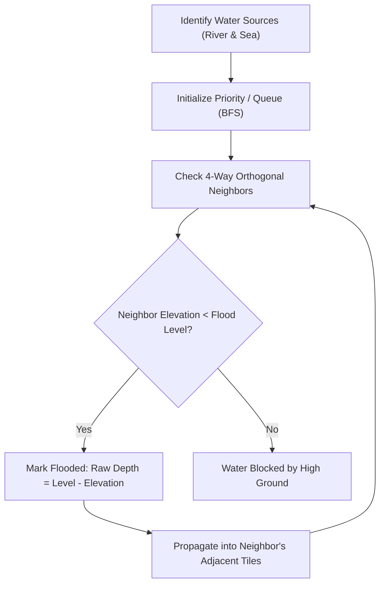

# Adaptasia Architecture & Engine Internals

This document details the software architecture, simulation models, procedural generation algorithms, and rendering pipeline of **Adaptasia**.

---

## Table of Contents

1. [Architectural Principles](#architectural-principles)
2. [Coordinate Systems & Grid Topology](#coordinate-systems--grid-topology)
3. [Module Breakdown](#module-breakdown)
   - [CONFIG (Game Balancing)](#1-config-game-balancing)
   - [UTIL (Math & Algorithms)](#2-util-math--algorithms)
   - [MAP (Procedural World Generation)](#3-map-procedural-world-generation)
   - [SIMULATION (State Management & Systems)](#4-simulation-state-management--systems)
   - [HAZARDS (Flooding & Thermal Models)](#5-hazards-flooding--thermal-models)
   - [SPRITES (Procedural Pixel Art Engine)](#6-sprites-procedural-pixel-art-engine)
   - [RENDER (Canvas Pipeline)](#7-render-canvas-pipeline)
   - [UI (Input, Overlays & Persistence)](#8-ui-input-overlays--persistence)
   - [BOOT (Lifecycle & Headless Bridge)](#9-boot-lifecycle--headless-bridge)
4. [Data Structures](#data-structures)
5. [Procedural Algorithms Deep-Dive](#procedural-algorithms-deep-dive)
6. [Testing & Headless Execution](#testing--headless-execution)

---

## Architectural Principles

Adaptasia was engineered around three strict constraints:

1. **Zero External Dependencies**: No npm packages, frameworks (React, Phaser), bundlers (Vite, Webpack), image assets, or external web fonts. The entire application is self-contained.
2. **Single-File Portability**: All HTML, CSS, JavaScript, sprites, fonts, and logic exist within a single file (`index.html`). Double-clicking the file in any browser runs the game immediately.
3. **Deterministic Simulation & Pixel Precision**: The game runs on a fixed **640x448 logical viewport** divided into a **32 x 24 tile grid** of **16x16 pixel tiles**. Canvas rendering uses integer scaling (`image-rendering: pixelated`) to maintain razor-sharp retro aesthetics across any monitor or mobile screen.

---

## Coordinate Systems & Grid Topology

### Grid Geometry
- **Logical Canvas Width ($W$)**: 640 px
- **Logical Canvas Height ($H$)**: 448 px
- **Tile Dimensions**: 16 x 16 px
- **Map Dimensions**: 32 Columns x 24 Rows ($N = 768$ tiles)
- **Map Origin on Screen**: $X = 124$ px, $Y = 30$ px

```
(0,0) ┌─────────────────────────── 640 px ───────────────────────────┐
      │ HUD: Budget, Pop, Jobs, Year, Happiness, Resilience          │ (Y=0 to 28)
      ├──────────┬───────────────────────────────────────────────────┤
      │ Tools &  │ MAP VIEWPORT (32 x 24 tiles = 512 x 384 px)       │
      │ Overlays │                                                   │
      │ Panel    │ (Map origin: X=124, Y=30)                         │
      │ (120 px) │                                                   │
      ├──────────┴───────────────────────────────────────────────────┤
      │ Bottom Status Bar: Climate Forecast, Tile Info, Tips         │ (Y=416 to 448)
      └───────────────────────────────────────────────────────────────┘
```

### Tile Indexing & Neighborhoods
Tiles are stored in a contiguous 1-dimensional array of length 768 ($32 \times 24$).
- Index mapping: $\text{idx}(x, y) = y \times \text{COLS} + x$
- Neighborhood traversals use Chebyshev distance (radius $r$ box) via `forRadius(x, y, r, callback)`.

---

## Module Breakdown

### 1. CONFIG (Game Balancing)
Contains all tunable gameplay numbers:
- Starting budget (\$25,000), win thresholds (5,000 pop, 70 resilience), loss thresholds (3 consecutive years in the red or < 20% happiness).
- Tax and economic rates: \$2.50 per resident, \$2.00 per job, 0.6 worker share.
- Hazard curves: Base probabilities, annual trend slopes, and extreme event multipliers.
- Item definition dictionary: Costs, upkeeps, flood capacities, heat reductions, amenity scores, failure rates, and maturity durations.

### 2. UTIL (Math & Algorithms)
- `mulberry32(seed)`: A 32-bit deterministic pseudo-random number generator ensuring reproducible map generation.
- `clamp(v, min, max)`: Bound clamping.
- `forRadius(x, y, r, fn)`: High-performance Chebyshev neighborhood scanner.
- `eff(item, age)`: Maturation curve calculator:
  $$\text{Efficiency}(\text{age}) = \begin{cases} 1.0 & \text{if item.mature} = 0 \\ 0.25 + 0.75 \times \min\left(1.0, \frac{\text{age}}{\text{mature}}\right) & \text{otherwise} \end{cases}$$

### 3. MAP (Procedural World Generation)
Generates varied, geologically coherent landscapes using seed-based procedural techniques:
1. **Coastline Generation**: Sinusoidal wave along the southern border creating natural bays and beaches.
2. **River Generation**: Meandering random-walk path starting from the north edge and flowing south to the sea, widening downstream.
3. **Elevation Model**: Multi-source Breadth-First Search (BFS) distance field calculating distance to water, combined with 2D bicubic value noise.
4. **Biome Tagging**: Elevation and proximity thresholds classify tiles into `land`, `river`, `sea`, `sand`, `flood`, and `hill`.

### 4. SIMULATION (State Management & Systems)
Handles state updates, construction rules, and annual progression:
- `newState(seed)`: Factory creating initial game state.
- `roadAccessMap(st)`: Bitmask array tracking which tiles are within 2 tiles of an active road.
- `canPlace(st, tool, x, y)`: Validation engine checking terrain permissions, budget, and occupancy.
- `computeHeat(st)`: Calculates localized microclimates and urban heat island effects.
- `computeLandValue(st)`: Computes land value based on water views, parks, commercial jobs, risk, and heat.
- `computeMetrics(st)`: Calculates total population, employment capacity, recreation, attractiveness, happiness targets, and composite resilience.
- `endYear(st)`: Evaluates yearly economic cycle (taxes - upkeep), advances population, applies hazard events, ages green infrastructure, and tests win/loss conditions.

### 5. HAZARDS (Flooding & Thermal Models)
- `floodDepths(st, level, mode, extreme)`: Simulates water propagation from water bodies into connected low-lying land. Computes nature-based absorption, storm drain mitigation, and levee barrier defense.
- `applyFlood(st, sev, extreme)`: Applies structural damage, counts population displacement, handles levee failures (+0.12 surge), and tracks building abandonment.
- `applyHeat(st, inten)`: Evaluates heat wave exposure above the 0.40 harm threshold and calculates cooling center mitigation.

### 6. SPRITES (Procedural Pixel Art Engine)
All visual assets are generated programmatically at boot time:
- `mk(fn, w, h)`: Creates an offscreen HTML5 `<canvas>` element and yields a drawing callback.
- `PAL`: A carefully curated 24-color retro palette (ink, navy, slate, steel, gray, pale, white, greens, blues, earth tones, warning colors).
- **Road Autotiling**: Procedurally builds all 16 road intersection variations using bitmasks ($N=1, E=2, S=4, W=8$).
- **Custom Font Engine**: 3x5 blocky bitmap font dictionary covering uppercase alphanumeric characters, numbers, and punctuation. Generates cached bitmap atlases for instant text rendering.

### 7. RENDER (Canvas Pipeline)
The render loop executes each animation frame:
1. Clear screen to background ink color (`#0f0f1b`).
2. Draw terrain, roads, buildings, and green roofs.
3. Apply active analytical overlays (Flood, Heat, Land Value).
4. Render animated event effects (flood water surge, heat shimmer waves).
5. Draw HUD, left toolbar buttons, and active hover reticles.
6. Render status bar forecast and tooltips.
7. Render modal dialogs and tutorial popups if active.

### 8. UI (Input, Overlays & Persistence)
- `toLocal(e)`: Translates browser mouse/touch events to integer canvas coordinates regardless of window size or screen aspect ratio.
- Drag-to-paint functionality for placing roads and zoning.
- State serialization to `localStorage` under `adaptasia_save_v1`.
- Step-by-step interactive modal tutorial system.

### 9. BOOT (Lifecycle & Headless Bridge)
- Initializes DOM canvas, builds sprites and button layouts, binds event listeners.
- Automatically initiates the `requestAnimationFrame` game loop.
- **Node.js Headless Export Bridge**: Detects `module.exports` and exports core functions for unit testing without requiring a browser window or DOM.

---

## Data Structures

### Game State Object (`state`)
```typescript
interface GameState {
  version: number;
  seed: number;
  year: number;               // 1 to 30
  budget: number;             // Currency ($)
  pop: number;                // Total population
  jobsCap: number;            // Total commercial jobs available
  filledJobs: number;         // Employed residents
  jobFactor: number;          // Jobs-to-labor ratio (0.3 - 1.2)
  happiness: number;          // 0 to 100
  happyTarget: number;        // Target equilibrium
  resilience: number;         // 0 to 100
  recreation: number;         // Total amenities
  attract: number;            // Attractiveness score (0 - 100)
  tiles: Tile[];              // Array of 768 tiles
  stats: {
    gray: number;             // Total spending on gray infrastructure
    nbs: number;              // Total spending on nature-based solutions
    dev: number;              // Total spending on roads & zoning
    damage: number;           // Total flood damage suffered ($)
    avoided: number;          // Total damage prevented by defenses ($)
    floods: number;           // Count of flood events
    heatwaves: number;        // Count of heat waves
    leveeFails: number;       // Count of levee breaches/overtoppings
    floodLoss: number;        // Total displaced residents
    heatLoss: number;         // Total heat wave casualties/relocations
    abandoned: number;        // Count of abandoned buildings
  };
  disasters: number[];        // Years when disasters hit
  hist: HistoryPoint[];       // Longitudinal tracking per year
  over: boolean;              // Game completion flag
  result: 'win' | 'bankrupt' | 'unhappy' | 'time' | null;
}
```

### Tile Object (`Tile`)
```typescript
interface Tile {
  t: 'land' | 'river' | 'sea' | 'sand' | 'flood' | 'hill'; // Biome
  e: number;                  // Elevation (0.0 to 1.0)
  v: number;                  // Visual variant (0 to 3)
  b: string | null;           // Built infrastructure ID
  age: number;                // Building age in years
  pop: number;                // Current resident population
  jobs: number;               // Current commercial jobs
  roof: boolean;              // Green roof upgrade installed?
  roofAge: number;            // Age of green roof in years
  ab: boolean;                // Abandoned ruin flag
  fh: number[];               // Flood history timestamps
  heat: number;               // Heat island index (0.0 to 1.0)
  lv: number;                 // Land value (0.0 to 1.0)
  risk: number;               // Net flood depth in design flood
  rawRisk: number;            // Raw flood depth without defenses
  cooled: number;             // Cooled by cooling center flag (0 or 1)
  scar: boolean;              // Levee breach scar indicator
}
```

---

## Procedural Algorithms Deep-Dive

### Flood Connectivity & Propagation
Flooding does not simply check tile elevation; it models **hydraulic connectivity**:

Once raw depths are determined:
1. **Nature-Based Retention**: Sums absorption from wetlands, bioswales, parks, and green roofs within their respective radii (capped at 0.20 per tile).
2. **Gray Drainage**: Sums drainage capacity from operational storm drains (capped at 0.20 per tile).
3. **Levee Defense**: Tiles within radius 2 of a levee are shielded up to the levee's 0.40 threshold. If water exceeds 0.40 or an extreme breach occurs, the levee is destroyed and an additional 0.12 surge depth is applied.

---

## Testing & Headless Execution

Because `adaptasia.html` conditionally exports its simulation logic when executed in a CommonJS environment:
```javascript
if (typeof module !== 'undefined') {
  module.exports = {
    CONFIG, newState, place, canPlace, endYear,
    recomputeAll, idx, inB, isWaterT, forRadius,
    levelFor, designLevel, lessons, roadAccessMap
  };
}
```

Headless test runners can extract the `<script>` block and execute automated unit tests without any browser dependencies.
- **Node.js**: `tests/test_simulation.js` validates terrain generation, zoning constraints, budget math, and disaster cascades.
- **Python**: `tests/test_integrity.py` validates repository structure, tags, and synchronization.
